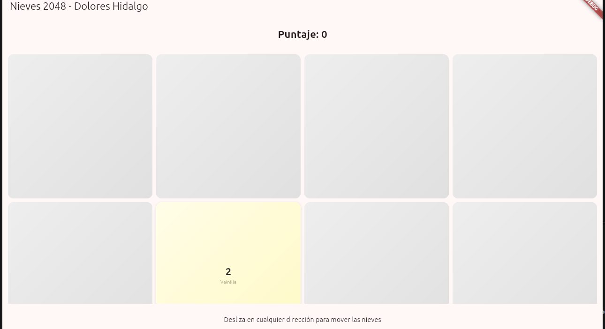
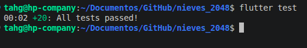

# nieves_2048

A new Flutter project.

## Getting Started

This project is a starting point for a Flutter application.

A few resources to get you started if this is your first Flutter project:

- [Learn Flutter](https://docs.flutter.dev/get-started/learn-flutter)
- [Write your first Flutter app](https://docs.flutter.dev/get-started/codelab)
- [Flutter learning resources](https://docs.flutter.dev/reference/learning-resources)

For help getting started with Flutter development, view the
[online documentation](https://docs.flutter.dev/), which offers tutorials,
samples, guidance on mobile development, and a full API reference.

# 🧊 Nieves 2048 ❄️

Un clásico juego de rompecabezas **2048**, desarrollado con Flutter. Desliza, combina y llega a la ficha 2048 (¡o más allá!).

## 📸 Capturas de Pantalla

Así luce el juego en acción:

### Interfaz del Juego
<p align="center">
  
</p>

### Estado de Game Over
<p align="center">
  
</p>

### Pruebas Automatizadas
<p align="center">
  
  <br>
  <i>Pruebas unitarias y de widgets ejecutándose correctamente con <code>flutter test</code>.</i>
</p>

---

## 🎮 ¿Cómo jugar?
El objetivo es deslizar las fichas en el tablero (Arriba, Abajo, Izquierda, Derecha). Cuando dos fichas con el mismo número chocan, se **fusionan en una sola**. 
*   Cada movimiento genera una nueva ficha (2 o 4).
*   Ganas cuando llegas a la ficha **2048**.
*   Pierdes cuando el tablero se llena y no hay movimientos posibles.

## 🚀 Cómo ejecutar el proyecto

### Requisitos previos
* Flutter SDK (versión estable)
* Dependencias de Linux para Flutter (si estás en Ubuntu/Debian):
  ```bash
  sudo apt-get install clang cmake ninja-build pkg-config libgtk-3-dev